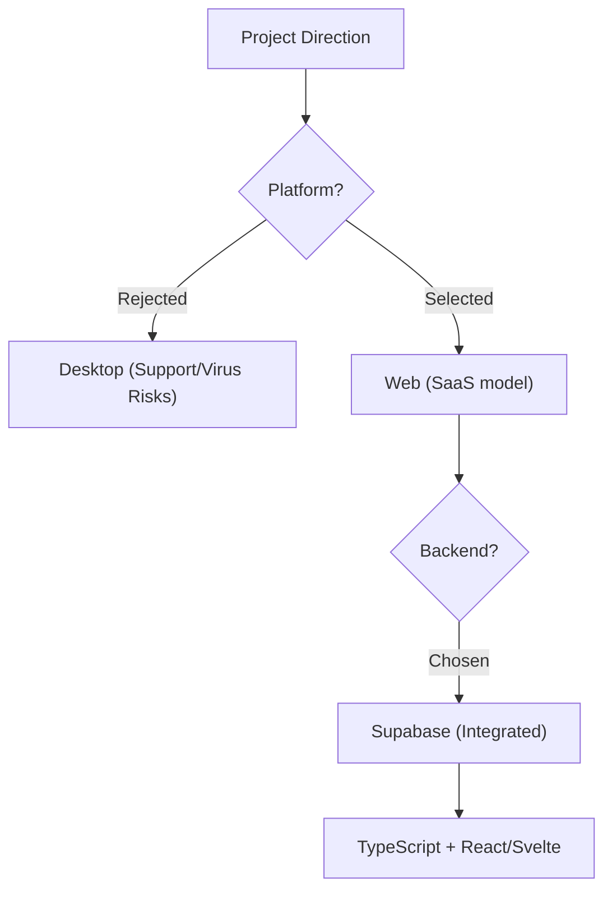
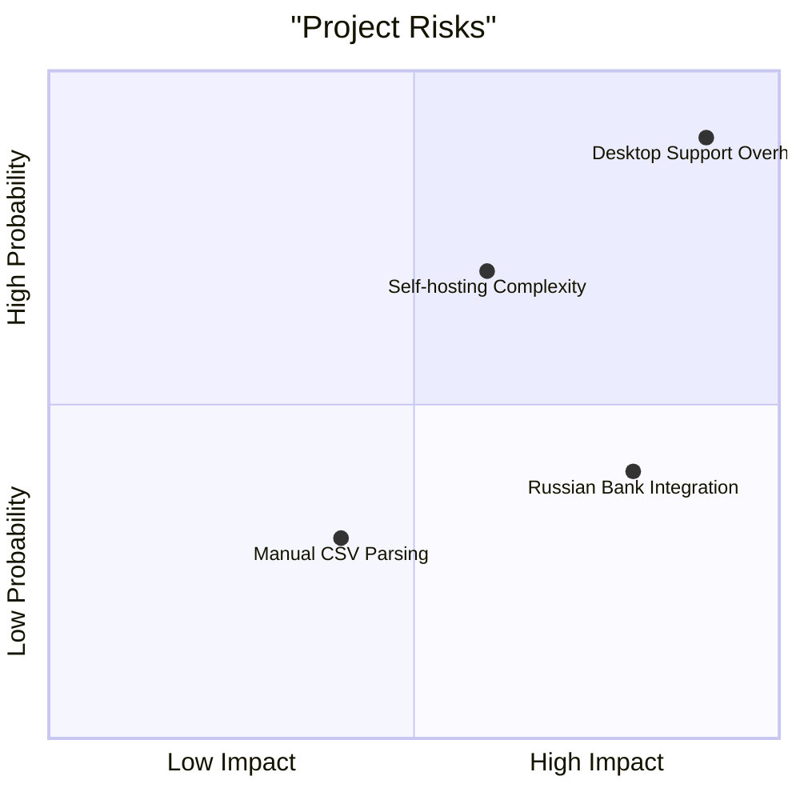
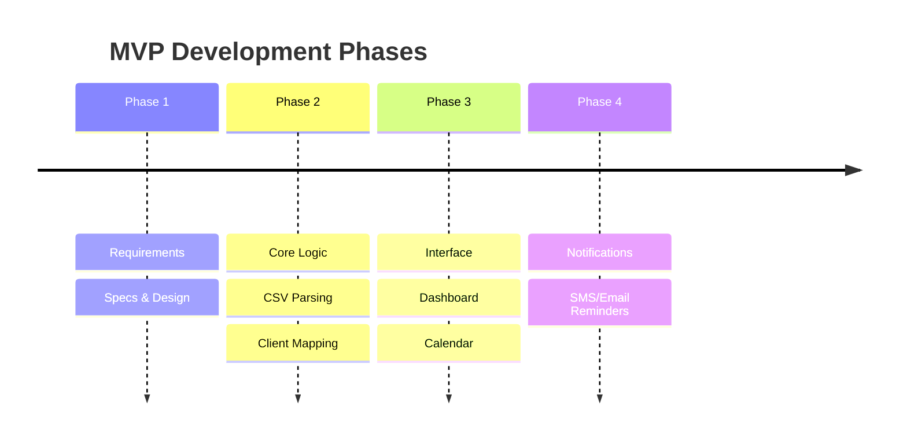
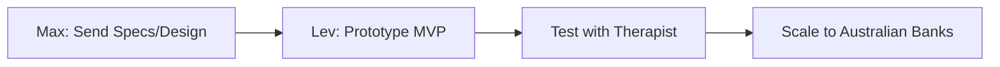
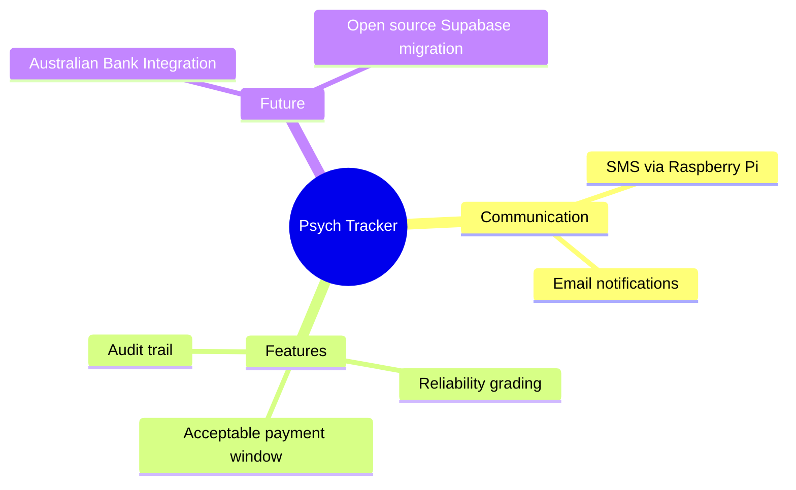

| 📅 Date | 🏷️ Meeting | 😀 Mood |
| :--- | :--- | :--- |
| 2026-07-08 | Project Psych-Tracker | Debative & Constructive |

---

## OVERVIEW

Max and Lev discuss a new SaaS tool for therapists to track client payments, debating web vs. desktop architecture and selecting a Supabase-based stack.

---

## Attendees

| Name | Role | Animal + ≤10 words | Movie character + ≤10 words |
| :--- | :--- | :--- | :--- |
| **Max** | Idea Generator | 🦊 Fox: Always questioning "why" and looking for gaps. | 🕵️ Sherlock Holmes: Investigates every technical detail meticulously. |
| **Lev** | Technical Lead | 🐻 Bear: Protects the project from risky desktop-support traps. | 🛠️ Tony Stark: Building complex integrated systems with Supabase. |

---

## KEY POINTS

<details>
<summary>
Details on recording, SaaS ideas, and technical debates.
</summary>

- Recording the session using the Fireflies tool.
- Automating video recording using Playwright and browser-based CLI commands.
- Lev's personal workflow for managing rental transactions and tenant reliability.
- Proposal for a simplified payment tracker for a psychologist friend.
- Intense debate regarding the support overhead of desktop vs. web apps.
- The workflow starts with manual CSV bank statement parsing.
- Dashboards should highlight today's appointments and overdue payments in red.
- SMS notifications via a physical Raspberry Pi modem to save costs.
- Selection of TypeScript, Next.js/Svelte, and Supabase for the tech stack.
- Supabase integrated features like RLS, Storage, and Auth are key.
- Self-hosting Supabase is complex and postponed for later scaling.

</details>

---

## DECISIONS

<details>
<summary>
Architectural and project scope choices.
</summary>

<!-- alt: Decision tree for platform and stack selection -->


</details>

---

## CHALLENGES

<details>
<summary>
Analysis of support risks and integration hurdles.
</summary>

<!-- alt: Risk matrix of identified project challenges -->


</details>

---

## TIMELINE

<details>
<summary>
Sequence for the MVP development.
</summary>

<!-- alt: Timeline of project phases -->


</details>

---

## TASKS

<details>
<summary>
Action items for Max and Lev.
</summary>

<!-- alt: Task assignments with ownership -->
```mermaid
gannt
    title Action Items
    dateFormat  YYYY-MM-DD
    section Max
    Send Specs & Design      :m1, 2026-07-09, 2d
    section Lev
    Build Small Focused MVP  :l1, after m1, 5d
```

</details>

---

## NEXT STEPS

<details>
<summary>
Immediate follow-up sequence.
</summary>

<!-- alt: Ordered sequence of next steps -->


</details>

---

## IDEAS

<details>
<summary>
Brainstormed features and future expansions.
</summary>

<!-- alt: Mindmap of project ideas -->


</details>

---

## REFERENCES

| Name | Note |
| :--- | :--- |
| **Fireflies** | Tool used for meeting recording. |
| **Playwright** | Automation tool for video recording. |
| **Supabase** | Backend infrastructure with Postgres and Auth. |
| **Raspberry Pi** | Proposed hardware for cost-effective SMS gateway. |
